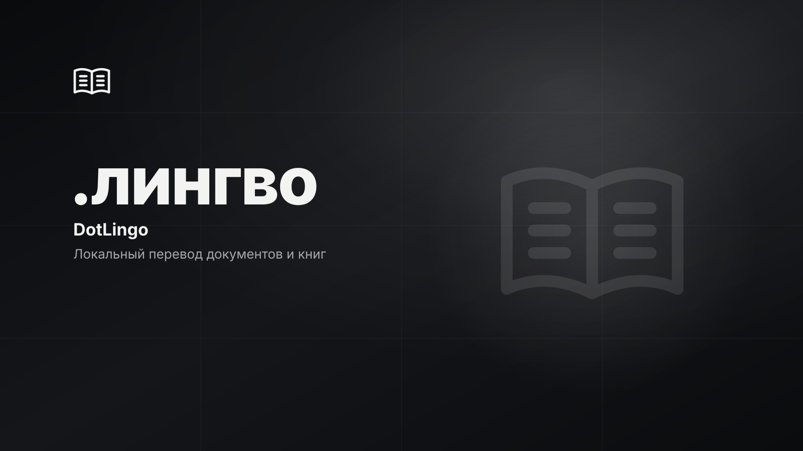

# DotLingo

<p>
  
  
  
  <!-- loc:start --><!-- loc:end -->
</p>



<!-- audit:start -->
<p>
  <a href="docs/audit/latest.md"></a>
  <a href="docs/audit/2026-10-11-quiet-harbor.md"></a>
</p>
<!-- audit:end -->

DotLingo переводит документы локально на Windows. Оригинал остаётся отдельной копией, окно открывает pywebview на Edge WebView2.

## Что внутри

- **Свой файл:** выбранный GGUF копируется в каталог моделей после подтверждения, с проверкой размера и SHA-256.
- **Редактор:** оригинал стоит рядом с переводом, черновик модели хранится отдельно от правки.
- **Глоссарий:** термин правится на месте, совпадение внутри фрагмента закрывается маркером.
- **Скан:** страница почти без текста читается Windows OCR, перевод пишется поверх картинки.
- **Экспорт:** DOCX и EPUB пишутся только из такого же исходника.
- **Данные:** проекты и модели лежат в `%LOCALAPPDATA%\DotLingo` и не делят каталог с кодом.

Подробности: [локальная установка](docs/LOCAL_SETUP.md), [модели](docs/MODEL_MATRIX.md), [архитектура](docs/ARCHITECTURE.md), [форматы](docs/FORMAT_MATRIX.md), [сборка Windows](docs/BUILD_WINDOWS.md).

## Запуск

Нужны Windows 10/11 x64, Git, сеть и CPython 3.12 или 3.13.

```powershell
git clone https://github.com/network-user/DotLingo.git
cd DotLingo
.\Install.bat
```

Ярлык на рабочем столе запускает `.venv\Scripts\pythonw.exe -m dotlingo`. Проекты и модели остаются в `%LOCALAPPDATA%\DotLingo`.

## Команды

| Действие                    | Команда |
|-----------------------------|---------|
| Скачать приложение          | `git clone https://github.com/network-user/DotLingo.git`, затем `.\Install.bat` |
| Запустить из клона          | `python -m dotlingo` |
| Обновить клон с origin/main | `.\deploy\update.ps1` |
| Headless-проверка моста     | `python -m dotlingo --smoke-test` |
| Запустить тесты             | `python -m pytest -q` |
| Проверить стиль             | `python -m ruff check src tests` |
| Собрать иконку              | `python scripts/build_icon.py` |
| Собрать Windows Setup.exe   | `.\deploy\windows\build.ps1` |

`Install.bat` ставит `pip install -e ".[pdf]"` и не скачивает колесо llama.cpp. Отдельный `Setup.exe` собирает `deploy\windows\build.ps1`, ярлык его не запускает.

## Стек

<p>
  
  
  
  
  
  
  
  
  
  
  
  
</p>

## Тесты

В `tests/` 23 модуля, PDF-fixture на PyMuPDF пропускается, если пакета нет.

## Архитектура

pywebview держит окно 1280x820 и раздаёт `web/` своим HTTP-сервером. Мост `api.py` вызывает ядро без UI, у каждого проекта свой `project.sqlite`.

```text
src/dotlingo/
├── app.py                 # окно, HTTP-раздача, --smoke-test, --data-dir
├── api.py                 # мост js_api: конверт, worker-потоки, push
├── web/                   # vanilla JS, без сборки
│   ├── index.html
│   ├── styles/            # tokens.css и листы страниц
│   └── js/                # bridge, store, router, страницы и мастер
├── hardware.py            # RAM, диск, CPU, GPU, план размещения
├── runtime_install.py     # колесо llama.cpp по кнопке
├── updater.py             # сверка клона с origin/main
├── models.py              # каталог и свои GGUF
├── models.json            # 4 закреплённых веса
├── model_download.py      # согласие, SHA-256, атомарная активация
├── market.py              # 6 репозиториев Hugging Face по кнопке
├── task_queue.py          # очередь перевода
├── engine.py              # отдельный процесс llama.cpp
├── scratch.py             # диалог без проекта, та же модель
├── dialogs.py             # сохранённые диалоги и вложения
├── storage.py             # SQLite на проект, копия оригинала
├── formats.py             # импорт и экспорт
├── pdf_layout.py          # текст PDF в те же полосы, иллюстрации остаются
├── image_layout.py        # OCR скана и текст поверх картинки
├── segmentation.py        # фрагменты
├── glossary.py            # маркеры терминов
├── languages.py           # подписи и коды языков модели
├── locale_hints.py        # язык интерфейса и клавиатуры
├── paths.py               # %LOCALAPPDATA%\DotLingo
└── preferences.py         # тема, мастер, последний проект, проверка обновлений
```

- Оригинал не меняется. Перевод и экспорт разделены по целевому языку.
- Ответ моста: `{ok, data}` либо `{ok: false, error, code}`. Долгий вызов возвращает `{started: true}`.
- Рекомендация модели смотрит всю RAM с запасом 1 ГБ и место на диске с запасом 10% размера файла.
- GPU получает слои, только если свободная VRAM дискретной карты покрывает расчёт и запас 1.4 ГБ.
- Клон сравнивает себя с `origin/main`. Кнопка в настройках или `deploy\update.ps1` ставит обновление и не трогает `%LOCALAPPDATA%\DotLingo`.

## Лицензия

© 2026 DotCore. Все права защищены.

Проприетарный код. Использование, копирование, изменение и распространение запрещены без письменного разрешения автора. Исходный код открыт только для ознакомления. См. [LICENSE](LICENSE).
